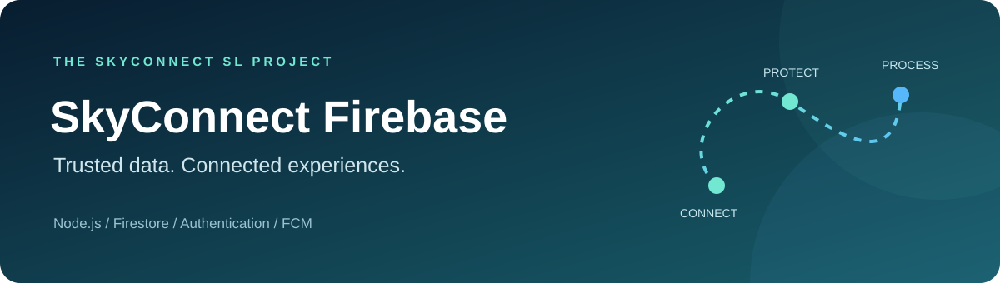
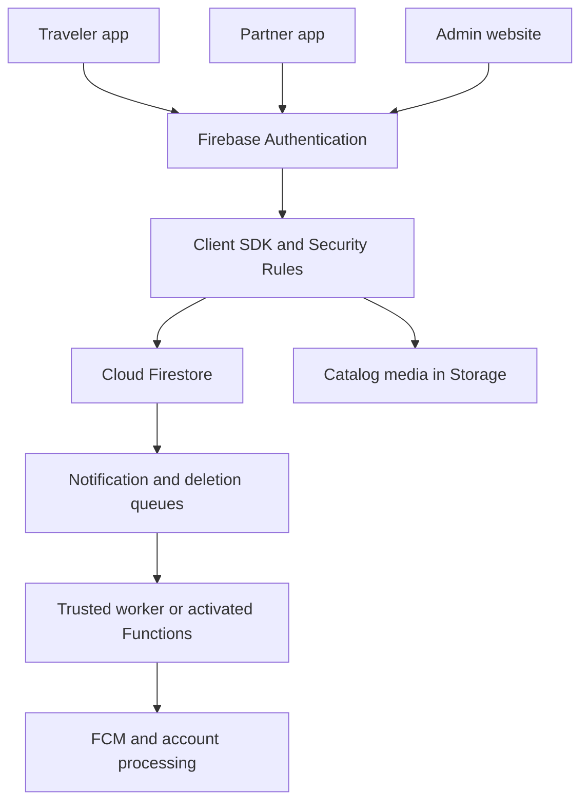

<p align="center">
  
</p>

<p align="center">
  <strong>The shared data and operations backend for SkyConnect SL.</strong><br />
  Firebase identity, Firestore authorization, catalog migration and trusted background processing.
</p>

<p align="center">
  
  
  
  
  
</p>

<p align="center"><a href="https://github.com/ChamiduPrabodya/SkyConnect-Backend-Firebase/actions/workflows/ci.yml"></a></p>

<p align="center">
  <a href="#overview">Overview</a> &middot;
  <a href="#architecture">Architecture</a> &middot;
  <a href="#quick-start">Quick start</a> &middot;
  <a href="#configuration">Configuration</a> &middot;
  <a href="#database-layout">Database layout</a> &middot;
  <a href="#testing">Testing</a> &middot;
  <a href="#roadmap">Roadmap</a>
</p>

## Overview

**SkyConnect Firebase** connects the traveler app, partner app and administration website to a shared Firebase project. This repository owns the **Firestore and Storage Rules**, indexes, catalog migration scripts, administrator provisioning and trusted notification/account-deletion processing.

It is a Firebase deployment and operations project, **not a standalone Express REST server**. Frontends use Firebase client SDKs under Security Rules; administrative scripts and workers use trusted server credentials. The separate [AI backend](https://github.com/IT24101654/SkyConnect-AI-Backend) handles Skylo model requests.

> **Repository status - 14 November 2026:** Rules, migration tooling, a polling worker and an alternative Cloud Functions package exist in source. Current cloud deployment, physical-device push delivery and complete production acceptance remain to be verified. Historical migrations do not establish the current live project's state.

## Features

| Capability | Implementation |
| --- | --- |
| Shared access model | Rules for travelers, partner-owned records and administrators |
| Administrator provisioning | Trusted script grants the `admin: true` Firebase custom claim |
| Catalog migration | Create-only full-media, no-image and reference-data seed paths |
| Media access | Storage Rules and preserved catalog asset manifests |
| Service requests | Provider-owned requests grouped by `tripGroupId` |
| Notification processing | Firestore inbox/device records and a trusted FCM polling worker |
| Account deletion | Shared deletion processor used by the worker and prepared Functions package |
| Event-driven alternative | Functions source for notifications, profile defaults and privacy processing |
| Verification | Unit tests, Rules tests and Functions/trigger emulator tooling |

There is no payment processor, issued ticket, guaranteed seat reservation or trained recommendation model here. Client-submitted prices are planning estimates, not verified charges.

## Architecture



Use one active notification sender mode. The prepared Functions implementation is an alternative to the polling worker; coordinate cutover through the existing mode controls.

## Technology stack

| Technology | Role |
| --- | --- |
| Node.js + ES modules | Scripts, trusted worker and shared processing code |
| Firebase Authentication | Shared accounts, ID tokens and administrator claims |
| Cloud Firestore | Catalog, profiles, requests, preferences and inbox data |
| Firestore / Storage Rules | Client authorization at the service boundary |
| Firebase Admin SDK | Privileged server operations and FCM delivery |
| Firebase CLI | Authentication, emulators and deployment commands |
| Cloud Functions | Prepared event-driven alternative; Node.js 22 runtime target |
| Node test runner + Rules test SDK | Unit and emulator-based verification |

Commands are declared in [package.json](package.json); the [Functions package](functions/package.json) has separate dependencies.

## Quick start

### Install and preview locally

Use Node.js **22.13+**, npm and Git for the shared development setup. Firestore emulator tests additionally require **Java 21+** with the installed Firebase CLI.

```powershell
git clone https://github.com/ChamiduPrabodya/SkyConnect-Backend-Firebase.git
cd SkyConnect-Backend-Firebase
npm.cmd ci

# Preview only: these commands do not apply the migration.
npm.cmd run seed:preview
npm.cmd run seed:references:preview
npm.cmd run seed:no-images:preview
npm.cmd test
```

This project has no `npm start` application server. Start the specific emulator, worker or migration operation you need.

### Start the trusted worker

```powershell
# First setup only; preserve existing configuration.
if (!(Test-Path .env.notifications.local)) {
  Copy-Item .env.notifications.example .env.notifications.local
}
npx.cmd firebase login
# Edit .env.notifications.local for the intended project before continuing.
npm.cmd run notifications:worker
```

The worker processes project queues and must remain running on an awake computer or continuously hosted process. Read [NOTIFICATIONS.md](NOTIFICATIONS.md) and [PRIVACY.md](PRIVACY.md) for device setup, operating mode and deletion scope.

## Configuration

Use [.env.notifications.example](.env.notifications.example) for worker configuration. Seed/admin scripts also read explicitly supplied environment variables.

| Setting | Purpose |
| --- | --- |
| `GOOGLE_CLOUD_PROJECT` | Target Firebase / Google Cloud project |
| `NOTIFICATION_ADMIN_UIDS` | Administrator recipients; their claim is checked at send time |
| `NOTIFICATION_POLL_MS` | Worker polling interval |
| `FIREBASE_STORAGE_BUCKET` | Media bucket; its configured name does not prove it exists |
| `SEED_ASSET_BASE_URL` | Optional existing HTTPS host for seed assets |
| Application Default Credentials | Trusted Admin SDK identity for seed/admin operations |
| Firebase CLI login | Supported by selected scripts and the `--firebase-cli` admin path |

Do not commit local credentials or service-account keys. Firebase CLI login and Application Default Credentials are different authentication paths; choose the one supported by the command being run.

### Administrator provisioning

Create the intended Firebase Authentication account first, then run as an authorized developer:

```powershell
$env:GOOGLE_CLOUD_PROJECT = 'YOUR_FIREBASE_PROJECT_ID'
npm.cmd run admin -- YOUR_ADMIN_AUTH_UID --firebase-cli
```

Sign out and back in to obtain the updated claim. Creating an ordinary email/password account alone does not grant administrator access.

## Database layout

| Collection / path | Purpose |
| --- | --- |
| `destinations` | Published places, embedded activities and planning metadata |
| `offers` / `packages` | Partner listings and administrator-managed bundles |
| `routes` / `flights` | Airline route submissions and legacy sample inventory |
| `partners/{uid}` | Partner registration, business profile and review state |
| `users/{uid}` | Traveler profile and private account-scoped subcollections |
| `users/{uid}/settings/preferences` | Interests, currency, theme and notification preferences |
| `users/{uid}/savedPlans` / `likes` | Saved trip snapshots and liked content |
| `bookings` | Separate service requests linked by traveler/provider and trip group |
| `referenceData` | Airports, countries, interests and planning reference lists |
| `legacySamples` | Administrator-only archives of retired illustrative datasets |

Sample records remain samples. Seeding does not create real supplier Auth accounts or verify businesses. Legacy records without ownership/publication fields require deliberate migration.

## Migration and deployment

Apply commands write to the selected project. Review previews and existing data first. Create-only seeding preserves existing IDs; conflicts require review. Full-media seeding does not automatically backfill previously created no-image records.

```powershell
$env:GOOGLE_CLOUD_PROJECT = 'YOUR_FIREBASE_PROJECT_ID'

# Choose the migration you need; these commands write data.
npm.cmd run seed:references
npm.cmd run seed:no-images

# Deploy reviewed Rules and indexes.
npx.cmd firebase deploy --only firestore,storage --project YOUR_FIREBASE_PROJECT_ID
```

The full-media alternative is `npm.cmd run seed` with an available bucket/asset host and authorized Admin SDK identity. Storage availability, billing eligibility and Functions deployment must be checked for the actual project. The [Functions README](functions/README.md) describes the separate event-driven package.

## Testing

```powershell
npm.cmd test
npm.cmd run test:rules

npm.cmd --prefix functions ci
npm.cmd run functions:check
npm.cmd run test:functions
npm.cmd run test:triggers
```

`npm test` runs backend tests; Rules cases skip without an emulator. `test:rules` and `test:functions` use a local demo-project Firestore emulator. Trigger verification uses the dedicated script. Local tests do not establish live deployment or real-device delivery.

## Project structure

```text
SkyConnect-Backend-Firebase/
|-- docs/assets/banner.svg      # Repository artwork
|-- firestore.rules            # Shared database authorization
|-- firestore.indexes.json     # Query indexes
|-- storage.rules              # Media access rules
|-- firebase.json              # Deployment and emulator configuration
|-- scripts/                   # Seed, admin, worker and verification tools
|-- notifications/             # Polling and notification logic
|-- functions/                 # Prepared event-driven implementation
|-- seed/                      # Catalog/reference manifests and preserved media
|-- tests/                     # Data, notification and Rules tests
|-- NOTIFICATIONS.md            # Worker/device setup and cutover
`-- PRIVACY.md                  # Consent/deletion operations
```

## Continuous integration

[**Firebase CI - view workflow runs**](https://github.com/ChamiduPrabodya/SkyConnect-Backend-Firebase/actions/workflows/ci.yml)

The workflow runs for pull requests, pushes to `main` and manual **Run workflow** requests. Data/notification unit tests, create-only seed previews, Java 21 demo-project Rules/Functions tests and trigger integration.

CI uses read-only repository permissions and requires no production Firebase credentials or Vertex keys. New runs cancel older runs for the same branch. Failed steps remain failed and their logs are available in the Actions tab. Emulator diagnostic logs are retained briefly when a job fails; no production data is seeded or deployed.

This workflow does not deploy services, publish mobile apps or change branch protection. Requiring a successful check before merge is a separate GitHub repository setting. Failure email delivery follows each user's GitHub Actions notification settings; it does not broadcast email to every collaborator.

## Roadmap

- [x] Shared Rules, indexes and create-only migration tooling
- [x] Administrator claim provisioning and provider-owned request records
- [x] Notification worker and shared deletion processing source
- [x] Prepared Functions alternative and emulator test tooling
- [ ] Strengthen booking transitions and trusted pricing
- [ ] Verify approved-provider restrictions, revocation and deletion behavior
- [ ] Complete native push configuration and physical-device delivery tests
- [ ] Verify current deployment and an always-on processing host
- [ ] Finish withdrawal, retention and connected-account acceptance

## Related repositories

| Repository | Responsibility |
| --- | --- |
| [Traveler app](https://github.com/ChamiduPrabodya/SkyConnect-user-app) | Discovery, planning, saved trips and Skylo UI |
| [Partner app](https://github.com/IT24101654/SkyConnect-partner-app) | Airline/tourism listings and service requests |
| [Admin website](https://github.com/ChamiduPrabodya/SkyConnect-SL-Admin-Web-App) | Verification, moderation and catalog management |
| [AI backend](https://github.com/IT24101654/SkyConnect-AI-Backend) | FastAPI, LangChain and Vertex integration |

## Development and licensing

Keep changes scoped, preserve asset attribution and use isolated demo data for authorization tests. No open-source license has been selected in this repository; do not assume an MIT grant.

<p align="center"><strong>SkyConnect SL &middot; One shared foundation for every journey.</strong></p>
